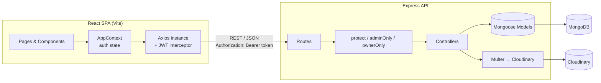
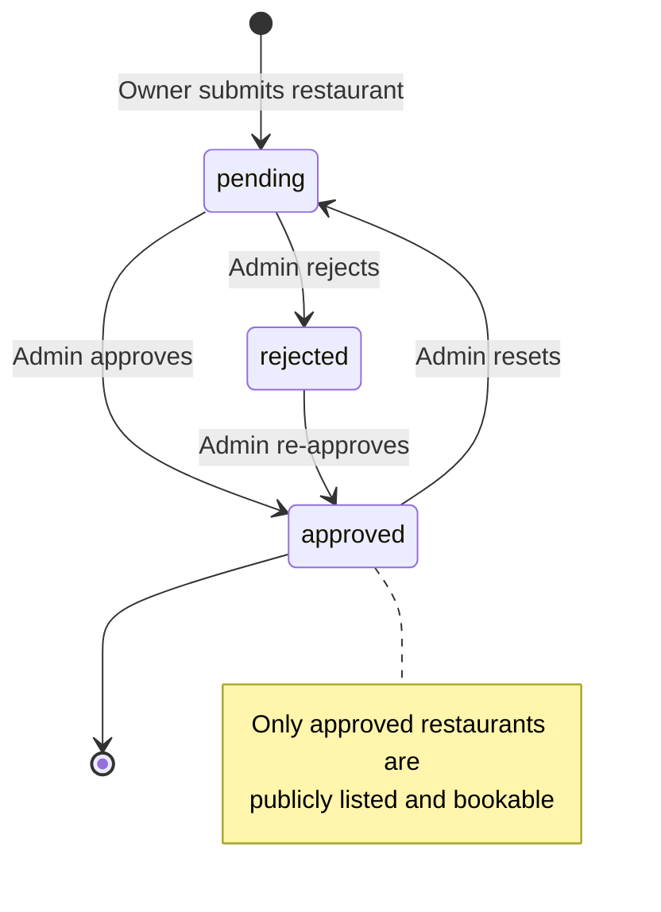

<div align="center">

# 🍽️ BiteMo

**A premium restaurant discovery & table-reservation platform built with the MERN stack and TypeScript.**

Guests browse and book tables, restaurant owners manage their venue and reservations, and admins approve new restaurants before they go live.


</div>

---

## 📑 Table of Contents

- [Overview](#-overview)
- [Features](#-features)
- [Tech Stack](#-tech-stack)
- [Architecture](#-architecture)
- [Project Structure](#-project-structure)
- [Getting Started](#-getting-started)
- [Environment Variables](#-environment-variables)
- [Seeding the Database](#-seeding-the-database)
- [Available Scripts](#-available-scripts)
- [API Reference](#-api-reference)
- [Data Models](#-data-models)
- [Frontend Routes](#-frontend-routes)
- [Authentication & Authorization](#-authentication--authorization)
- [Key Business Logic](#-key-business-logic)
- [Deployment](#-deployment)
- [Known Issues & Roadmap](#-known-issues--roadmap)
- [Author](#-author)

---

## 🔎 Overview

BiteMo is a three-role, full-stack web application for fine-dining reservations:

| Role | What they can do |
| --- | --- |
| **Guest / User** | Search and filter restaurants, view details, check live seat availability, book a table, view and cancel their reservations. |
| **Restaurant Owner** | Register a restaurant (with cover image upload), wait for admin approval, then manage profile details, seating capacity, time slots and incoming bookings. |
| **Admin** | Review every restaurant, approve / reject / reset listings, and see platform-wide statistics and the latest bookings. |

The repository is a **monorepo** with two independent apps:

```
BiteMo-App/
├── client/   → React + Vite + Tailwind single-page app
└── server/   → Express + MongoDB REST API
```

---

## ✨ Features

### For diners
- 🔍 **Search & filter** restaurants by name, tag or location, price range and minimum rating, with sorting (newest, rating, price low→high, price high→low). Filters are stored in the URL query string, so search results are shareable.
- 🏠 **Home page** with hero search, *Browse by Cuisine* tiles, a *Trending* row of featured restaurants, a membership section and a newsletter CTA.
- 📄 **Restaurant detail page** (by slug) with hero image, info, tags, chef, and a booking widget.
- 🪑 **Live seat availability** per time slot for the chosen date, calculated from existing confirmed bookings.
- 📝 **Booking flow**: pick date, guests and slot → confirmation form (contact details, occasion, special requests) → success screen with a generated booking ID.
- 📅 **Personal dashboard** with *Upcoming* bookings (cancellable) and a *Past & Cancelled* history table.

### For restaurant owners
- 🧙 **Setup wizard** to create the restaurant profile (name, description, cuisine, price range, location, address, chef, tags, time slots, total seats, cover image).
- ⏳ **Approval states**: *Pending* and *Rejected* screens until an admin approves.
- 📋 **Bookings management** for the owner's restaurant, including status updates.
- ⚙️ **Profile editor** to update details, slots, seating capacity and the cover image.

### For admins
- ✅ **Approvals panel** to approve / reject / reset any restaurant.
- 📊 **Stats panel** with total users, owners, restaurants, bookings, and the 10 latest bookings.

### Platform
- 🔐 JWT authentication with bcrypt-hashed passwords and role-based route protection (frontend **and** backend).
- ☁️ Image upload pipeline: Multer (memory storage, 5 MB limit) → Cloudinary.
- 🔔 Toast notifications, loading states and a responsive, editorial UI (Playfair Display + Outfit typography, black/gold palette).

---

## 🧰 Tech Stack

### Frontend (`/client`)
| Area | Technology |
| --- | --- |
| Framework | React 19 + TypeScript |
| Build tool | Vite 8 |
| Styling | Tailwind CSS 4 (via `@tailwindcss/vite`, custom `@theme` design tokens) |
| Routing | React Router DOM 7 |
| HTTP | Axios (with a JWT request interceptor) |
| Icons | `lucide-react` + Google Material Symbols |
| Notifications | `react-hot-toast` |
| State | React Context (`AppContext`) |
| Linting | ESLint 10 + typescript-eslint |

### Backend (`/server`)
| Area | Technology |
| --- | --- |
| Runtime / framework | Node.js + Express 5 (ESM, TypeScript) |
| Database | MongoDB + Mongoose 9 |
| Auth | `jsonwebtoken` (30-day tokens) + `bcrypt` |
| File upload | Multer (in-memory) |
| Image hosting | Cloudinary |
| Dev tooling | `tsx`, `nodemon`, `ts-node` |

---

## 🏗 Architecture



### Restaurant lifecycle



---

## 📁 Project Structure

```
BiteMo-App/
├── client/
│   ├── public/                    # Logos, favicons, restaurant images
│   ├── src/
│   │   ├── assets/                # Images + assets.ts (cuisines, dummy reviews)
│   │   ├── components/
│   │   │   ├── admin/             # AdminApprovals, AdminStats
│   │   │   ├── booking/           # BookingForm, BookingSummary, BookingSuccess
│   │   │   ├── home/              # Hero, CuisineBrowse, TrendingRow, MembershipSection, NewsletterCTA
│   │   │   ├── owner/             # RestaurantWizard, OwnerBookings, OwnerProfileDetails,
│   │   │   │                      # PendingApproval, RequestRejected
│   │   │   ├── restaurant/        # RestaurantHero, RestaurantInfo, RestaurantReviews, BookingWidget
│   │   │   ├── AuthModal.tsx      # Login / Register modal
│   │   │   ├── Navbar.tsx
│   │   │   ├── Footer.tsx
│   │   │   ├── Loader.tsx
│   │   │   ├── ProtectedRoute.tsx # Auth + role guard
│   │   │   └── RestaurantCard.tsx
│   │   ├── context/AppContext.tsx # Auth state: user, token, login, register, logout
│   │   ├── lib/api.ts             # Axios instance (baseURL + JWT interceptor)
│   │   ├── pages/
│   │   │   ├── Home.tsx
│   │   │   ├── Search.tsx
│   │   │   ├── RestaurantDetail.tsx
│   │   │   ├── BookingConfirmation.tsx
│   │   │   ├── Dashboard.tsx      # User bookings
│   │   │   ├── owner/OwnerDashboard.tsx
│   │   │   └── admin/AdminDashboard.tsx
│   │   ├── App.tsx                # Route table
│   │   ├── main.tsx               # Entry (BrowserRouter + Context provider)
│   │   └── index.css              # Tailwind + design tokens
│   ├── vercel.json                # SPA rewrite
│   └── vite.config.ts
│
└── server/
    ├── config/
    │   ├── cloudinary.ts          # Cloudinary SDK config (fails fast if env missing)
    │   ├── db.ts                  # MongoDB connection
    │   └── multer.ts              # Memory storage, 5 MB limit
    ├── controllers/               # authcontroller, restaurentcontroller, bookingcontroller,
    │                              # ownercontroller, admincontroller
    ├── middlewares/auth.ts        # protect, adminOnly, ownerOnly
    ├── models/                    # User, Restaurent, booking
    ├── routes/                    # authRoutes, restaurentRoutes, bookingRoutes,
    │                              # ownerRoutes, adminRoutes
    ├── seed.ts                    # Demo data seeder
    ├── server.ts                  # App entry point
    └── vercel.json                # Vercel serverless config
```

---

## 🚀 Getting Started

### Prerequisites

- **Node.js** 20.19+ (22+ recommended; required by recent Vite versions)
- **Yarn** (the repo ships `yarn.lock` files; `npm` also works)
- A **MongoDB** database ([MongoDB Atlas](https://www.mongodb.com/atlas) free tier or a local instance)
- A **Cloudinary** account (free tier is enough) for restaurant image uploads

### 1. Clone the repository

```bash
git clone https://github.com/Ayush-verma25/BiteMo-App.git
cd BiteMo-App
```

### 2. Set up the backend

```bash
cd server
yarn install
```

Create `server/.env` (see [Environment Variables](#-environment-variables)), then:

```bash
yarn server        # development with auto-reload (nodemon + tsx)
```

The API is now available at **http://localhost:5000** (health check: `GET /` → `Server is running!`).

### 3. Set up the frontend

Open a second terminal:

```bash
cd client
yarn install
```

Create `client/.env`:

```env
VITE_API_URL=http://localhost:5000/api
```

```bash
yarn dev
```

The app is now available at **http://localhost:5173**.

### 4. (Optional) Load demo data

```bash
cd server
npx tsx seed.ts
```

See [Seeding the Database](#-seeding-the-database) for the demo accounts.

---

## 🔐 Environment Variables

> ⚠️ Never commit `.env` files. The root `.gitignore` already excludes `.env` and `node_modules`.

### `server/.env`

| Variable | Required | Description |
| --- | :---: | --- |
| `MONGODB_URI` | ✅ | MongoDB connection string. |
| `JWT_SECRET` | ✅ | Long, random secret used to sign JWTs. |
| `CLOUDINARY_CLOUD_NAME` | ✅ | Cloudinary cloud name. The server throws on startup if missing. |
| `CLOUDINARY_API_KEY` | ✅ | Cloudinary API key. |
| `CLOUDINARY_API_SECRET` | ✅ | Cloudinary API secret. |
| `PORT` | ❌ | HTTP port (defaults to `5000`). |
| `NODE_ENV` | ❌ | Set to `production` in production. |

```env
MONGODB_URI=mongodb+srv://<user>:<password>@<cluster>.mongodb.net/bitemo
JWT_SECRET=replace-with-a-long-random-string
CLOUDINARY_CLOUD_NAME=your_cloud_name
CLOUDINARY_API_KEY=your_api_key
CLOUDINARY_API_SECRET=your_api_secret
PORT=5000
```

### `client/.env`

| Variable | Required | Description |
| --- | :---: | --- |
| `VITE_API_URL` | ❌ | Base URL of the API **including** `/api`. Defaults to `http://localhost:5000/api`. |

---

## 🌱 Seeding the Database

`server/seed.ts` populates the database with demo users and restaurants.

```bash
cd server
npx tsx seed.ts
```

> ⚠️ **Destructive:** the script runs `deleteMany({})` on the **Users**, **Restaurants** and **Bookings** collections before inserting. Run it only on a development database.

**Demo accounts**

| Role | Email | Password |
| --- | --- | --- |
| Admin | `admin@example.com` | `Admin12345` |
| User | `user@example.com` | `User12345` |
| Owner | `owner@example.com` | `Owner12345` |

**Demo restaurants** (all pre-approved and owned by the demo owner): *L'Essence*, *Terraza Cielo*, *Kuro Omakase*, *Flora Garden*, *Ember Grille* and *L'Artiste* — spanning French, Italian, Japanese, Vegetarian and Steakhouse cuisines, with varying price ranges, slots and seating capacity.

> 💡 The admin role cannot be chosen from the sign-up form, so use the seeded admin account (or change a user's `role` directly in MongoDB) to access the admin dashboard.

---

## 📜 Available Scripts

### Server (`/server`)

| Command | Description |
| --- | --- |
| `yarn server` | Start the API in watch mode (`nodemon --exec tsx server.ts`). |
| `yarn start` | Start the API once (`tsx server.ts`). |
| `yarn build` | Type-check / compile with `tsc` into `./dist`. |
| `npx tsx seed.ts` | Seed demo data. |

### Client (`/client`)

| Command | Description |
| --- | --- |
| `yarn dev` | Start the Vite dev server. |
| `yarn build` | Type-check (`tsc -b`) and build for production. |
| `yarn preview` | Preview the production build locally. |
| `yarn lint` | Run ESLint. |

---

## 📡 API Reference

**Base URL:** `http://localhost:5000/api`
Protected endpoints require the header `Authorization: Bearer <token>`.

### Auth — `/api/auth`

| Method | Endpoint | Access | Description |
| --- | --- | --- | --- |
| `POST` | `/register` | Public | Create an account. Body: `name`, `email`, `password`, `phone?`, `role?`. Returns the user + JWT. |
| `POST` | `/login` | Public | Log in with `email` + `password`. Returns the user + JWT. |
| `GET` | `/me` | Private | Return the currently authenticated user. |

### Restaurants — `/api/restaurants`

| Method | Endpoint | Access | Description |
| --- | --- | --- | --- |
| `GET` | `/` | Public | List **approved** restaurants. Query: `search`, `location`, `priceRange` (repeatable), `rating` (minimum), `sort` (`rating` \| `price_low` \| `price_high`). |
| `GET` | `/featured` | Public | Up to 6 approved restaurants flagged `featured` **and** `exclusive`. |
| `GET` | `/:slug` | Public* | Restaurant by slug. *Non-approved restaurants are visible only to their owner or an admin.* |
| `GET` | `/:id/availability?date=YYYY-MM-DD` | Public | Remaining seats for each time slot on a given date. |

### Bookings — `/api/bookings`

| Method | Endpoint | Access | Description |
| --- | --- | --- | --- |
| `POST` | `/` | Private | Create a booking. Body: `restaurantId`, `date`, `time`, `guests`, `occasion?`, `specialRequests?`. |
| `GET` | `/my` | Private | The current user's bookings (newest first). |
| `PUT` | `/:id/cancel` | Private | Cancel one of your own bookings. |

### Owner — `/api/owner` (role: `owner` or `admin`)

| Method | Endpoint | Description |
| --- | --- | --- |
| `GET` | `/restaurant` | Get the owner's restaurant (`null` if none yet). |
| `POST` | `/restaurant` | Create the restaurant (`multipart/form-data`, optional `image` file). Starts as `pending`. One restaurant per owner. |
| `PUT` | `/restaurant` | Update restaurant details / image (`multipart/form-data`). |
| `GET` | `/bookings` | All bookings for the owner's restaurant, with guest contact info. |
| `PUT` | `/bookings/:id/status` | Update a booking's status. |

### Admin — `/api/admin` (role: `admin`)

| Method | Endpoint | Description |
| --- | --- | --- |
| `GET` | `/restaurants` | All restaurants (any status) with owner info. |
| `PUT` | `/restaurants/:id/approve` | Set status. Body: `{ "status": "approved" \| "rejected" \| "pending" }`. |
| `GET` | `/stats` | User / owner / restaurant / booking totals plus the 10 latest bookings. |

---

## 🗄 Data Models

```mermaid
erDiagram
    USER ||--o{ BOOKING : makes
    USER ||--o| RESTAURANT : owns
    RESTAURANT ||--o{ BOOKING : receives

    USER {
        ObjectId _id
        string name
        string email "unique"
        string password "bcrypt hash, min 8"
        string phone
        string role "user | owner | admin"
    }
    RESTAURANT {
        ObjectId _id
        string name
        string slug "unique"
        string description
        string cuisine
        string priceRange "$ | $$ | $$$ | $$$$"
        number rating
        number reviewCount
        string location
        string address
        string image
        string chef
        string[] tags
        string[] availableSlots
        boolean featured
        boolean exclusive
        ObjectId owner
        string status "pending | approved | rejected"
        number totalSeats "default 20"
    }
    BOOKING {
        ObjectId _id
        ObjectId user
        ObjectId restaurant
        date date
        string time
        number guests
        string occasion
        string specialRequests
        string status "confirmed | cancelled | completed"
        string bookingId "GR-XXXXXXXX"
    }
```

Notes:
- All models use `timestamps: true` (`createdAt` / `updatedAt`).
- The `User` schema strips `password` from JSON output.
- `bookingId` is auto-generated in a `pre("save")` hook as `GR-` + 8 random hex characters.
- The Mongoose model/collection is spelled `Restaurent` in the code.

---

## 🧭 Frontend Routes

| Path | Page | Access |
| --- | --- | --- |
| `/` | Home | Public |
| `/search` | Search & filter restaurants | Public |
| `/restaurant/:slug` | Restaurant details + booking widget | Public |
| `/booking/:slug?date=&guests=` | Booking confirmation form | Logged-in |
| `/dashboard` | My bookings | Logged-in |
| `/owner/dashboard` | Restaurant portal | Role: `owner` |
| `/admin/dashboard` | Admin console | Role: `admin` |

`ProtectedRoute` shows a "Login to continue" prompt (opening the auth modal) for anonymous users and an "Access Denied" screen for users with the wrong role.

---

## 🔒 Authentication & Authorization

1. On register/login the API returns the user plus a **JWT** (payload `{ id }`, valid for **30 days**).
2. The client stores the token in `localStorage` and the Axios request interceptor in `client/src/lib/api.ts` attaches it as `Authorization: Bearer <token>`.
3. On page load, `AppContext` calls `GET /auth/me` to restore the session; failure logs the user out.
4. Server middleware (`server/middlewares/auth.ts`):
   - `protect` — verifies the JWT and loads the user (without password).
   - `adminOnly` — allows only `admin`.
   - `ownerOnly` — allows `owner` and `admin`.
5. Ownership checks are enforced in controllers (users can cancel only their own bookings; owners can update only bookings for their own restaurant).

---

## ⚙️ Key Business Logic

**Seat availability.** Each restaurant has `totalSeats` (default 20) and a list of `availableSlots`. For a given date and slot, the booked seats are the sum of `guests` across bookings with `status: "confirmed"`; the remaining seats are `totalSeats − bookedSeats`. The same calculation powers the availability endpoint and the check performed when creating a booking.

**Approval workflow.** New restaurants are created as `pending`. Only `approved` restaurants appear in search/featured lists and can accept bookings.

**Slugs.** A URL-friendly slug is generated from the restaurant name (`"L'Essence"` → `l-essence`) and must be unique.

**Owner image upload.** The image is received in memory by Multer (max 5 MB), streamed to Cloudinary, and the returned `secure_url` is saved on the restaurant.

---

## ☁️ Deployment

Both apps include a `vercel.json`, so they can be deployed to [Vercel](https://vercel.com) as two separate projects:

- **Server** (`/server`): built with `@vercel/node` from `server.ts`; all routes are forwarded to the Express app. Add the server environment variables in the Vercel dashboard.
- **Client** (`/client`): standard Vite build; `vercel.json` rewrites every path to `/` so React Router deep links work. Set `VITE_API_URL` to your deployed API URL (ending in `/api`).

Other hosts (Render, Railway, Netlify, etc.) work as well — run the API as a regular Node process (`yarn start`) and serve `client/dist` as a static site.

---

## 🐞 Known Issues & Roadmap

An honest list of things worth improving, found while reviewing the code:

**Bugs / security**
- [ ] **Role escalation on sign-up:** `POST /auth/register` trusts the `role` field from the request body, so a direct API call can create an `admin`. Restrict it to `user` / `owner`.
- [ ] **Missing `return` in `createBooking`:** when a slot is over capacity the 400 response is sent but execution continues, which can still create the booking. Add a `return` after the response.
- [ ] **Typo in owner booking status:** `updateBookingStatus` validates against `"cancilled"` instead of `"cancelled"`, so owners cannot cancel a booking.
- [ ] **Client error messages:** the frontend reads `error.responce` (typo for `response`), so server error messages are never displayed.
- [ ] **CORS is fully open** (`app.use(cors())`); restrict it to the frontend origin in production.
- [ ] Add rate limiting and request validation (e.g. Zod / express-validator).

**Functionality gaps**
- [ ] The **cuisine filter** on the Search page sends a `cuisine` query param that the API does not handle yet.
- [ ] **Reviews** on the restaurant page use static dummy data (`dummyReviews`); there is no review model or endpoint yet.
- [ ] `/restaurants/featured` requires both `featured` and `exclusive` to be `true`.
- [ ] Booking past dates / time slots is only prevented in the date picker, not on the server.
- [ ] Newsletter and membership sections are UI only.

**Polish**
- [ ] A few leftover names from an earlier brand: "QuickDine" in UI copy and the `GR-` booking ID prefix.
- [ ] Owner uploads go to a Cloudinary folder named `test` — rename it.
- [ ] One seeded image path (`/restaurant_1.jpg`) does not match the file in `client/public` (`restaurant_1.png`).
- [ ] Add a `seed` npm script, automated tests and CI.
- [ ] Add a `LICENSE` file (the server `package.json` declares MIT).

**Ideas**
- Email / SMS booking confirmations, payments or deposits, real reviews & ratings, map view, owner analytics, multi-restaurant owners.

---

## 👤 Author

**Ayush Verma** — [@Ayush-verma25](https://github.com/Ayush-verma25)

If you find this project useful, consider giving it a ⭐ on GitHub!
